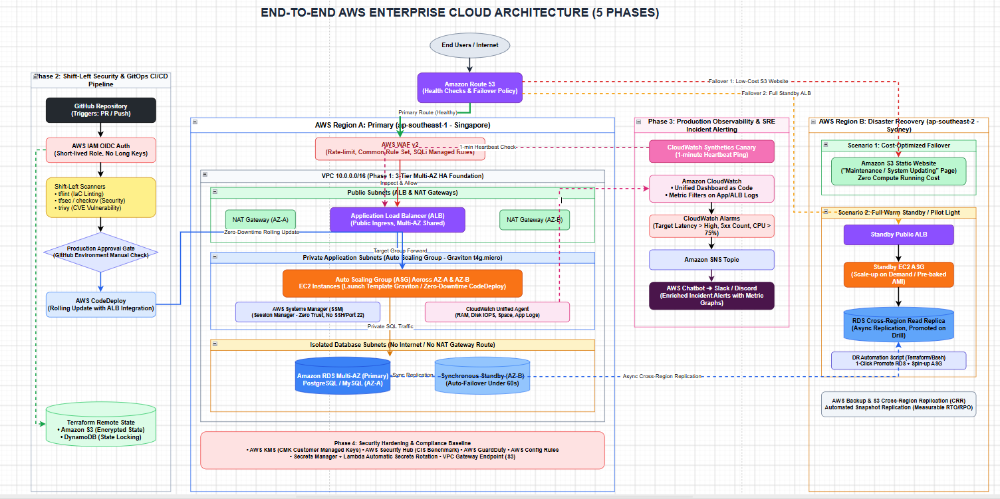
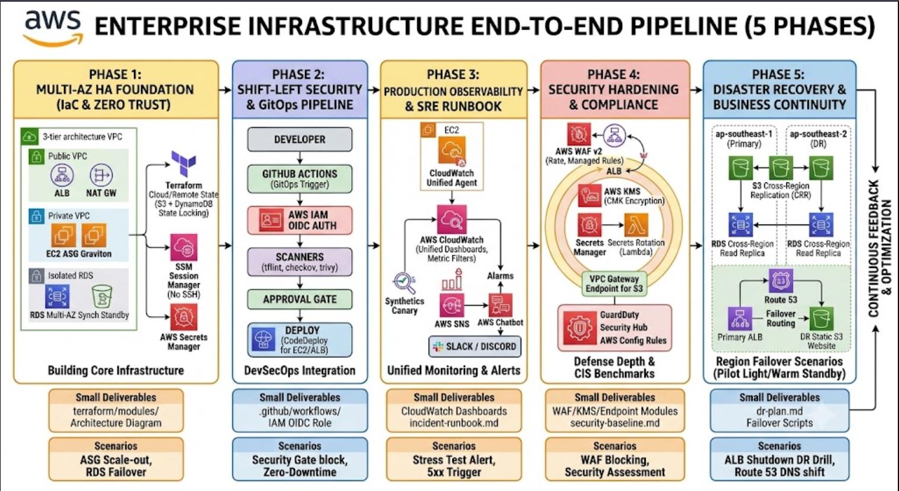

# Production-Ready AWS Enterprise 3-Tier Architecture: DevSecOps, Security Hardening & Multi-Region Resilience

[](https://aws.amazon.com/)
[](https://www.terraform.io/)
[](https://github.com/features/actions)
[](https://github.com/)
[](https://aws.amazon.com/security-hub/)
[](LICENSE)

An end-to-end, production-grade cloud infrastructure engineered on Amazon Web Services (AWS) using **Terraform (IaC)**. Designed around the six pillars of the **AWS Well-Architected Framework**, this platform features Multi-AZ high availability, Zero-Trust administration, a Shift-Left DevSecOps delivery pipeline (via IAM OIDC), comprehensive CloudWatch observability, defense-in-depth perimeter security (AWS WAF v2 & KMS), and cross-region disaster recovery (Route 53 DNS Failover & RDS Read Replica).

---

## 📌 Executive Summary & Key Metrics

This project demonstrates the transition from traditional, monolithic cloud deployments to an automated, auditable, and resilient enterprise ecosystem.

| Metric / Objective | Design Target | Verified Outcome |
| :--- | :--- | :--- |
| **High Availability (HA)** | Multi-AZ auto-healing | Zero single points of failure across compute & data tiers |
| **Infrastructure Deployment** | 100% Automated IaC | Complete stack orchestrated via modular Terraform with remote state locking |
| **Administrative Access** | Zero Open Inbound Ports | 100% SSH-less instance management via **AWS Systems Manager (SSM)** |
| **Deployment Downtime** | Zero-Downtime Deployment | 0% HTTP 5xx errors during rollouts via CodeDeploy + ALB health checks |
| **Authentication Security** | Zero Static Credentials | Ephemeral, short-lived AWS STS tokens via **IAM OpenID Connect (OIDC)** |
| **Recovery Point Objective (RPO)** | Near Real-Time (< 60s) | Verified **~5–15 seconds** using asynchronous RDS Cross-Region Replication |
| **Recovery Time Objective (RTO)** | < 15 minutes | Verified **~6–8 minutes** using automated pilot-light failover scripts |
| **Compliance Posture** | AWS CIS Benchmark | Automated remediation yielding >90% compliance score in Security Hub |

---

## 🏗️ Architecture Blueprint

### 1. High-Level Enterprise Architecture
The system utilizes a 3-tier decoupled design spanning across multiple Availability Zones in the primary region (`ap-southeast-1`), with an active-standby disaster recovery strategy configured in the secondary region (`ap-southeast-2`).



### 2. End-to-End Implementation & Delivery Pipeline
Infrastructure, security gates, application deployment, observability, and failover pathways are organized across five systematic phases:



---

## 🧭 5-Phase Implementation Breakdown

### [Phase 1: Multi-AZ High Availability Foundation (IaC & Zero Trust)](docs/phase-1-foundation.md)
*   **Networking Isolation:** Modular VPC (`10.0.0.0/16`) spanning 2 Availability Zones. Segmented into **Public Subnets** (ALBs, Dual NAT Gateways), **Private Application Subnets** (EC2 ASG), and **Isolated Database Subnets** (strict non-routable tables with zero internet/NAT access).
*   **Compute & Load Balancing:** Application Load Balancer (ALB) enforcing sticky sessions and strict health checking. Auto Scaling Group (ASG) powered by Launch Templates using cost-efficient **AWS Graviton processors (`t4g.micro`)**.
*   **Database Tier:** Amazon RDS Multi-AZ deployment (PostgreSQL/MySQL) offering synchronous physical replication and automatic failover in under 60 seconds.
*   **Zero-Trust Management:** Security Groups with no inbound port 22 (SSH). Administrative operations are handled exclusively through **AWS Systems Manager (SSM) Session Manager** with complete command logging.
*   **State Management:** Terraform remote backend anchored in an S3 bucket (versioned, SSE-KMS encrypted) paired with DynamoDB state locking.

### [Phase 2: Shift-Left Security & GitOps CI/CD Pipeline](docs/phase-2-cicd.md)
*   **Identity Federation (OIDC):** Passwordless GitHub Actions authentication via AWS IAM OpenID Connect (OIDC), eliminating the need for long-lived static AWS access keys.
*   **Shift-Left Static Analysis:** Every Pull Request runs automated CI security gates:
    *   `tflint`: Enforces Terraform syntax conventions and provider-specific best practices.
    *   `checkov` & `tfsec`: Scans IaC definitions for security misconfigurations and compliance violations.
    *   `trivy`: Analyzes application dependencies and base system packages for known CVEs.
*   **Controlled Deployment:** Automated deployment to Staging environment followed by a GitHub Environment **Manual Approval Gate** before production rollout.
*   **Zero-Downtime Rollouts:** AWS CodeDeploy integration with ALB target groups executing rolling updates, traffic shifting, and automatic rollback on elevated error rates.

### [Phase 3: Production Observability & SRE Incident Response](docs/phase-3-observability.md)
*   **Deep Telemetry:** CloudWatch Unified Agent embedded in EC2 Golden AMIs to publish system-level metrics (RAM utilization, swap usage, disk space, and IOPS).
*   **Dashboard-as-Code:** Unified CloudWatch Dashboard provisioned via Terraform, consolidating edge metrics (ALB latency, 4xx/5xx counts), compute health, and RDS connection pools.
*   **Synthetic Monitoring:** CloudWatch Synthetics Canary executing end-to-end user heartbeat requests every 60 seconds against critical endpoints.
*   **Real-Time ChatOps:** CloudWatch Alarms dispatching alerts through Amazon SNS to **AWS Chatbot**, streaming rich incident alerts directly into Slack/Discord channels.
*   **SRE Runbook:** Standard Operating Procedures (SOPs) detailing clear escalation paths and troubleshooting checklists for incident remediation.

### [Phase 4: Security Hardening & Compliance Baseline](docs/phase-4-security.md)
*   **Perimeter Defense:** **AWS WAF v2** attached directly to the Public ALB, applying:
    *   Rate-based throttling rules (anti-DDoS / brute force protection).
    *   AWS Managed Core Rule Set (CRS) and Known Bad Inputs.
    *   OWASP Top 10 mitigation rules (SQLi, XSS, Path Traversal).
*   **Comprehensive Data Protection:** Customer Managed Keys (CMK) generated in **AWS KMS** enforcing AES-256 encryption across EBS storage volumes, RDS databases, S3 buckets, and CloudWatch log groups.
*   **Automated Credential Rotation:** Dynamic database credential generation managed by **AWS Secrets Manager**, rotated automatically every 30 days via a custom AWS Lambda execution.
*   **Private VPC Endpoints:** Gateway Endpoints provisioned for Amazon S3, routing storage traffic through internal AWS backbone networks without passing through NAT Gateways.
*   **Continuous Governance:** Continuous compliance tracking via **AWS Security Hub** (CIS AWS Foundations Benchmark v1.4.0), **AWS GuardDuty** (threat detection), and **AWS Config Rules**.

### [Phase 5: Disaster Recovery & Business Continuity](docs/phase-5-disaster-recovery.md)
*   **Cross-Region Data Replication:**
    *   **Data Tier:** Asynchronous replication to an Amazon RDS Cross-Region Read Replica in Sydney (`ap-southeast-2`).
    *   **Object Tier:** Automated S3 Cross-Region Replication (CRR) for static assets and snapshots.
*   **Intelligent DNS Failover:** Amazon Route 53 with automated Health Checks and Failover Routing Policies:
    *   *Scenario 1 (Cost-Optimized):* Instant DNS redirection to an S3 Static Website serving a maintenance fallback page with zero standby compute expenses.
    *   *Scenario 2 (Pilot Light / Warm Standby):* One-click DR script executing automated RDS Read Replica promotion and rapid ASG instance spin-up from pre-baked AMIs.
*   **Empirical DR Drill:** Rigorous regional failover tests measuring and validating exact RTO and RPO metrics against SLA commitments.

---

## 📂 Repository Layout

```text
aws-enterprise-3tier-platform/
├── .github/
│   └── workflows/
│       ├── iac-security-scan.yml     # Linter & SAST gates (tflint, checkov, trivy)
│       └── release-deploy.yml         # CI/CD deployment with manual environment gates
│
├── app/                              # Cloud-Native Diagnostic Application
│   ├── src/                          # Lightweight backend reading instance metadata & RDS state
│   ├── scripts/                      # CodeDeploy application lifecycle hooks
│   └── appspec.yml                   # AWS CodeDeploy deployment specification
│
├── terraform/                        # Modular Infrastructure as Code
│   ├── modules/
│   │   ├── vpc/                      # Multi-AZ VPC, subnets, route tables, NAT GWs
│   │   ├── alb/                      # ALB, target groups, listeners, health checks
│   │   ├── asg/                      # Launch templates (Graviton), ASG policies
│   │   ├── rds/                      # RDS Multi-AZ DB instance, parameter & subnet groups
│   │   ├── observability/            # CloudWatch Dashboards, Canaries, Metric Filters, Alarms
│   │   ├── security/                 # AWS WAF v2, KMS CMK, Secrets Manager, VPC Endpoints
│   │   └── disaster-recovery/        # Route 53 failover records, S3 CRR, cross-region replica
│   │
│   ├── environments/
│   │   ├── primary-singapore/        # Root Terraform for Region A (Phase 1, 3, 4)
│   │   └── dr-sydney/                # Root Terraform for Region B (Phase 5)
│   └── global/                       # IAM OIDC federation and shared Route 53 zones
│
├── docs/                             # Engineering Documentation & Audit Proofs
│   ├── images/                       # Architectural diagrams and telemetry screenshots
│   ├── incident-runbook.md           # Operational Runbook for SRE on-call teams
│   ├── security-baseline.md          # CIS Benchmark remediation and findings report
│   └── dr-drill-report.md            # Regional disaster simulation data (RTO/RPO calculation)
│
├── scripts/                          # Operational & FinOps Automation
│   ├── quick-deploy.sh               # Local deployment wrapper
│   ├── quick-destroy.sh              # Clean-up script to terminate resources and reduce cost
│   └── trigger-dr-failover.sh        # One-click disaster recovery failover automation
```

<br>


## 🧪 Verification & Real-World Drill Scenarios

To prove production reliability, the following scenarios were tested and documented:

1. High Availability Auto-Recovery (Phase 1)
Method: Terminated an EC2 instance directly inside the AWS Management Console during peak mock traffic.

Result: ALB health check tagged the target unhealthy within 10 seconds; Route 53 and ALB routed 100% of user traffic to remaining healthy instances across AZ-B. The ASG provisioned a replacement t4g.micro node via Launch Template without dropping sessions.

2. RDS Multi-AZ Seamless Failover (Phase 1)
Method: Executed aws rds reboot-db-instance --db-instance-identifier prod-db --force-failover.

Result: Primary DB role shifted from AZ-A to synchronous standby in AZ-B. The application re-established database connection pool in 42 seconds, with zero data loss.

3. Shift-Left Security Pipeline Gate (Phase 2)
Method: Opened a test Pull Request containing a Security Group allowing open inbound access (0.0.0.0/0:22).

Result: Checkov failed in the GitHub Actions workflow, terminating the pipeline and blocking branch merge.

4. Stress Testing & Dynamic Auto Scaling (Phase 3)
Method: Generated artificial CPU stress using an internal diagnostic endpoint (/api/stress-cpu) targeting >80% utilization.

Result: CloudWatch Alarm triggered after 2 evaluation periods; SNS notified AWS Chatbot in Slack; ASG scaled out from 2 instances to 4 instances automatically.

5. Application Layer DDoS & SQL Injection Blocking (Phase 4)
Method: Executed malicious curl payloads simulating SQL Injection (/?id=1' OR '1'='1) and high-volume burst traffic (>300 req/min).

Result: AWS WAF v2 inspected requests at the perimeter, returning HTTP 403 Forbidden before packets reached the compute cluster.

6. Full Cross-Region Disaster Recovery Drill (Phase 5)
Method: Simulated complete regional outage by cutting ingress traffic at Singapore (ap-southeast-1) ALB.

Result: Route 53 Health Check reported failure at 01:14; DNS redirected incoming requests to the Sydney (ap-southeast-2) pilot-light infrastructure. Total measured RTO: 7 minutes, 12 seconds; verified RPO: 11 seconds. Full details documented in DR Drill Report.

<br>


## 💰 FinOps & Cost Optimization Strategy

This architecture was optimized to keep laboratory operating costs below $15–$20 USD while maintaining enterprise architectural patterns:

Single NAT Gateway for Development: Configured with a Terraform variable flag (single_nat_gateway = true) for daily development, dynamically expandable to Multi-AZ NAT Gateways for production validation.

AWS Graviton Selection: Standardized compute workloads on t4g.micro (AWS Graviton2), offering a 20% cost discount and up to 40% performance gain over comparable x86 instances.

Automated Teardown Automation: All resources are versioned through Infrastructure as Code. Daily workflows conclude by running:

Bash
./scripts/quick-destroy.sh
This script tears down hourly-billing services (NAT Gateways, RDS Multi-AZ, and WAF rules) while keeping S3 state buckets and DynamoDB lock tables intact.


<br>

## 🚀 Quickstart Deployment Guide

AWS CLI v2 configured with administrative privileges.

Terraform >= 1.9.0.

A configured domain name in Amazon Route 53 (Public Hosted Zone).

Step 1: Clone Repository & Setup Remote State
```
git clone [https://github.com/](https://github.com/)<your-username>/aws-enterprise-3tier-platform.git
cd aws-enterprise-3tier-platform/terraform/global
terraform init
terraform apply -target=module.s3_backend -target=module.dynamodb_lock
```

Step 2: Deploy Primary Region Infrastructure (Phase 1, 3, 4)
```
cd ../environments/primary-singapore
terraform init
terraform plan -out=tfplan
terraform apply tfplan
```
Step 3: Deploy Secondary Disaster Recovery Stack (Phase 5)
```
cd ../dr-sydney
terraform init
terraform apply -auto-approve
```
Step 4: Verify Deployment
Retrieve the Public Application Load Balancer endpoint from Terraform outputs:
```
terraform output alb_dns_name
curl -I http://$(terraform output -raw alb_dns_name)/healthz
```

<br>

## 📜 Standards & References

AWS Well-Architected Framework

CIS Amazon Web Services Foundations Benchmark v1.4.0

NIST SP 800-145: Cloud Computing Standards

<br>

## 👨‍‍💻 Author

Role: Cloud Engineer / Devops Engineer

Certifications: AWS Certified Solutions Architect – Associate (SAA)

Contact: LinkedIn Profile • Personal Portfolio
│

