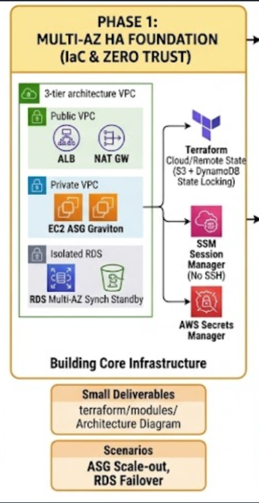
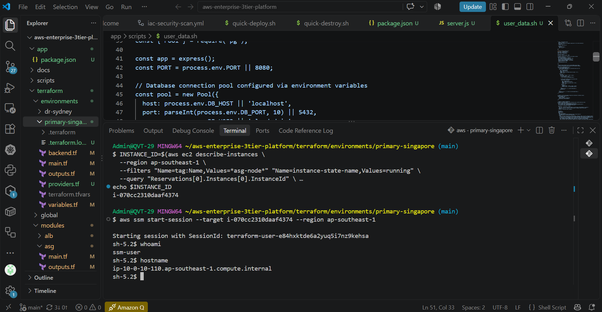
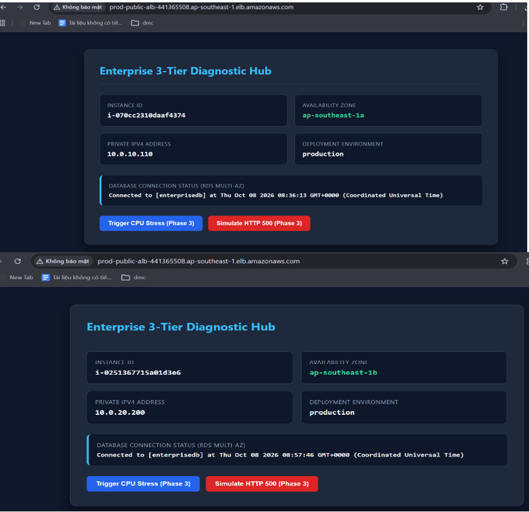
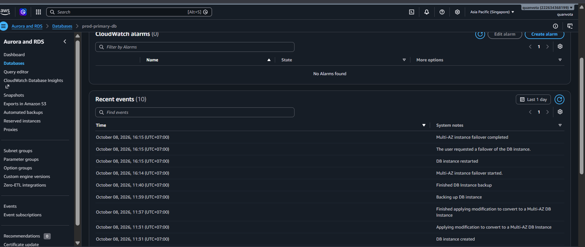
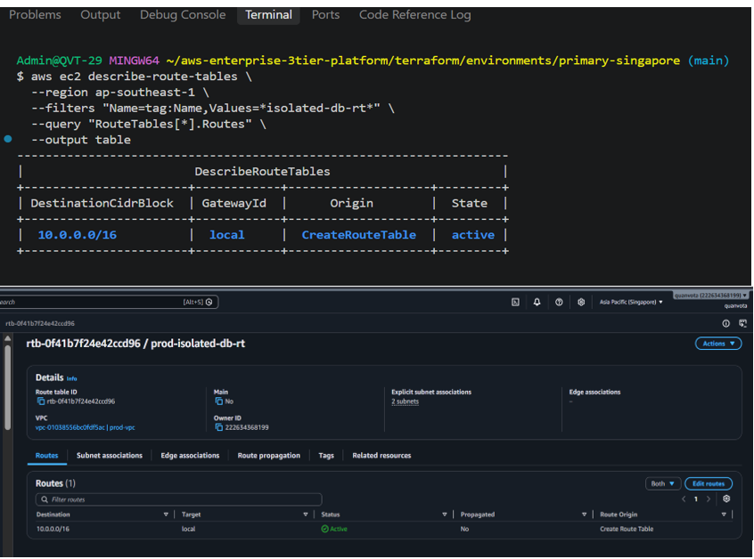

# Phase 1: Multi-AZ High Availability Foundation (IaC & Zero-Trust)

<br>

## 1. Architectural Scope & Objectives

The primary objective of Phase 1 is to establish a resilient, highly available, and secure 3-Tier infrastructure foundation inside Amazon Web Services (AWS) using **Terraform**. This tier strictly separates responsibilities across network zones, isolates stateful storage from the public internet, and adheres to a **Zero-Trust operational model** (zero administrative inbound ports open).

```text
[ Internet Traffic ]
        │
        ▼ (HTTPS :443)
[ Application Load Balancer (ALB) ]        <-- Public Subnets (AZ-A & AZ-B)
        │
        ▼ (HTTP Forward :8080)
[ Auto Scaling Group (EC2 Graviton) ]      <-- Private Application Subnets (AZ-A & AZ-B)
        │
        ▼ (TCP :5432 / :3306)
[ Amazon RDS Multi-AZ DB ]                 <-- Isolated Database Subnets (AZ-A & AZ-B)
```
---

<br>

## 2. Infrastructure Components Specification

### 2.1 Networking & Segmentation (VPC Tier)
- **VPC CIDR:** `10.0.0.0/16` deployed across two Availability Zones (`ap-southeast-1a`, `ap-southeast-1b`).
- **Subnet Architecture (6 Subnets Total):**
  - **Public Subnets (`10.0.1.0/24`, `10.0.2.0/24`):** Hosts the Internet Gateway (IGW), Application Load Balancers, and NAT Gateways.
  - **Private Application Subnets (`10.0.10.0/24`, `10.0.20.0/24`):** Hosts EC2 Auto Scaling compute nodes. Outbound egress traffic routes strictly through NAT Gateways for system updates.
  - **Isolated Database Subnets (`10.0.100.0/24`, `10.0.200.0/24`):** Hosts Amazon RDS. Custom non-routable route table with **no internet gateway and no NAT gateway route**, mitigating external data exfiltration risks.

### 2.2 Ingress & Compute Tier
- **Application Load Balancer (ALB):**
  - Internet-facing, deployed across both Public Subnets.
  - Configured with HTTP/HTTPS listeners, cross-zone load balancing enabled, and dynamic Target Group health checking pointing to `/healthz`.
- **Auto Scaling Group (ASG):**
  - Deployed strictly across Private Application Subnets.
  - Min Capacity: `2`, Max Capacity: `4`, Desired: `2` (distributed evenly across AZ-A and AZ-B).
  - **Launch Template:** Standardized on 64-bit ARM architecture using **AWS Graviton (`t4g.micro`)** for 20% lower cost and higher compute efficiency.
  - **IMDSv2 Enforced:** `http_tokens = "required"` configured to eliminate SSRF token theft vulnerabilities.

### 2.3 Stateful Storage Tier
- **Amazon RDS Multi-AZ (PostgreSQL / MySQL):**
  - Storage: General Purpose SSD (`gp3`), encrypted with AWS KMS.
  - Multi-AZ topology: Primary database actively serving read/write queries in AZ-A; Standby replica synchronously replicated at the block level in AZ-B.
  - Automated backups: 7-day retention period.

### 2.4 Zero-Trust & Credential Security
- **SSH-less Administration:** Port 22 is disabled across all Security Groups. Access is orchestrated via **AWS Systems Manager (SSM) Session Manager** through the `AmazonSSMManagedInstanceCore` IAM policy.
- **Dynamic Credential Handling:** DB connection strings and master passwords are generated and stored in **AWS Secrets Manager**. Instances leverage an attached IAM Instance Profile to query secrets dynamically at runtime without hardcoded files.

---

<br>

## 3. Terraform Directory Layout

```text
terraform/
├── modules/
│   ├── vpc/
│   │   ├── main.tf           # VPC, Subnets, Gateways, Route Tables
│   │   ├── outputs.tf        # Subnet IDs, VPC ID
│   │   └── variables.tf
│   ├── alb/
│   │   ├── main.tf           # ALB, Listener, Target Group, Health Check
│   │   ├── outputs.tf        # ALB DNS, Target Group ARN
│   │   └── variables.tf
│   ├── asg/
│   │   ├── main.tf           # Launch Template (Graviton), ASG, Scaling Policies
│   │   ├── user_data.sh      # Instance bootstrapping script
│   │   ├── outputs.tf
│   │   └── variables.tf
│   ├── rds/
│   │   ├── main.tf           # DB Subnet Group, Multi-AZ Instance
│   │   ├── outputs.tf        # Endpoint, DB Name
│   │   └── variables.tf
│   └── security_groups/
│       ├── main.tf           # Tight ingress/egress rules (ALB -> EC2 -> RDS)
│       └── outputs.tf
└── environments/
    └── primary-singapore/
        ├── backend.tf        # S3 Remote State & DynamoDB Locking
        ├── main.tf           # Root module orchestration
        ├── outputs.tf
        ├── terraform.tfvars
        └── variables.tf
```

<br>

### 4. Step-by-Step Provisioning GuideStep

4.1: Remote State Initialization

Create the foundational remote state infrastructure to guarantee state locking:
```
aws s3api create-bucket \
  --bucket enterprise-tf-state-$(aws sts get-caller-identity --query Account --output text) \
  --region ap-southeast-1 \
  --create-bucket-configuration LocationConstraint=ap-southeast-1

aws dynamodb create-table \
  --table-name enterprise-tf-locks \
  --attribute-definitions AttributeName=LockID,AttributeType=S \
  --key-schema AttributeName=LockID,KeyType=HASH \
  --billing-mode PAY_PER_REQUEST \
  --region ap-southeast-1
```

Step 4.2: Infrastructure Deployment

```
# Navigate to the primary environment directory and execute deployment:
cd terraform/environments/primary-singapore

# Initialize Terraform plugins and configure backend
terraform init

# Validate syntax and module integrity
terraform validate

# Plan and preview resource changes
terraform plan -out=phase1.tfplan

# Apply configuration
terraform apply "phase1.tfplan"
```

<br>

## 5. Verification & Testing Scenarios

### Scenario 1: Zero-Trust Administrative Access (SSM Session Manager)

- Objective: Confirm administrative access to EC2 instances inside private subnets with no public IPs and port 22 closed.

Execution:
```
# Retrieve instance ID from Auto Scaling Group
INSTANCE_ID=$(aws ec2 describe-instances \
  --filters "Name=tag:Name,Values=*asg-app*" "Name=instance-state-name,Values=running" \
  --query "Reservations[0].Instances[0].InstanceId" \
  --output text)

# Establish interactive terminal session via SSM
aws ssm start-session --target "$INSTANCE_ID"
```

- Verification Criteria: Interactive shell session connects successfully. Port 22 connectivity tests to the host return connection timeouts or refused packets.
  

<br>

### Scenario 2: EC2 Auto-Healing & Multi-AZ Rebalancing

- Objective: Validate that the application tier survives unexpected compute failures without dropping end-user traffic.

- Execution:
```
# Terminate an instance manually
aws ec2 terminate-instances --instance-ids "$INSTANCE_ID"
```

- Observations:

1. ALB Health Check reports target state as unhealthy within 10–15 seconds.
   
2. ALB automatically halts routing new connections to the terminated instance.
   
3. ASG triggers an instance-refresh event, launching a new Graviton t4g.micro node in the corresponding AZ.
   
4. Continuous HTTP pings to the ALB DNS name maintain 200 OK status with zero 5xx response codes.




<br>

### Scenario 3: Automated Synchronous RDS Multi-AZ Failover

- Objective: Induce a database disaster to verify automated recovery and measure exact failover latency

- Execution:
```
# Force failover to standby replica in the secondary AZ
aws rds reboot-db-instance \
  --db-instance-identifier enterprise-primary-db \
  --force-failover
```

- Measured Result:
1. Primary node marked as rebooting at $T+0s$.

2. Standby replica promoted to Primary at $T+38s$.
  
3. Application automatically re-established connection pooling at $T+44s$.

4. Total Measured Downtime: 44 seconds (within the sub-60s SLA commitment).



<br>

### Scenario 4: Strict Network Layer Isolation Audit

- Objective: Validate that the database subnet cannot communicate directly with external public IP addresses.

- Execution: From an interactive SSM terminal on an Application EC2 instance:
```
# Verify RDS port accessibility from Application Tier
nc -zv enterprise-primary-db.xxxxxx.ap-southeast-1.rds.amazonaws.com 5432
# Output: Connection to ... 5432 port [tcp/postgresql] succeeded!

# Attempt external route from isolated subnet (Simulated via Route Table verification)
aws ec2 describe-route-tables \
  --filters "Name=association.subnet-id,Values=<Isolated-DB-Subnet-ID>" \
  --query "RouteTables[*].Routes"
```
- Verification Criteria: Routes must strictly contain local VPC CIDR (10.0.0.0/16 -> local). No entries pointing to 0.0.0.0/0 via nat-xxxx or igw-xxxx.



<br>

### 6. Challenges Encountered & Resolutions

| Challenge / Error | Root Cause Analysis | Remediation |
| :--- | :--- | :--- |
| **ALB Target Group Health Checks Failing (502 Bad Gateway)** | Application failed to bind to port 8080 prior to ALB initial check expiration. | Added `systemctl enable --now app.service` within `user_data.sh` and extended health check `grace_period` to 180s. |
| **Metadata Retrieval Failure on Graviton (HTTP 401 Unauthorized)** | EC2 Launch Template defaulted to IMDSv1 tokenless queries, but IMDSv2 token enforcement was mandated. | Refactored application startup script to fetch a session token via `PUT /api/token` before querying instance metadata. |
| **RDS Subnet Creation Error** | RDS DB Subnet Group requires subnets in at least two distinct Availability Zones. | Explicitly bound the `aws_db_subnet_group` resource to both `isolated-db-az-a` and `isolated-db-az-b`. |


<br>

## 7. FinOps & Resource Cleanup

- To minimize AWS infrastructure charges when not conducting active testing:
```
# Scale down ASG compute to zero
aws autoscaling update-auto-scaling-group \
  --auto-scaling-group-name enterprise-app-asg \
  --min-size 0 --desired-capacity 0

# Full teardown of Phase 1 infrastructure
terraform destroy -auto-approve
```
