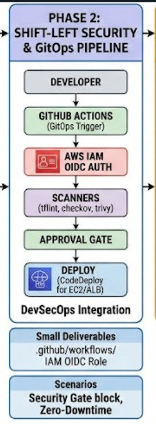
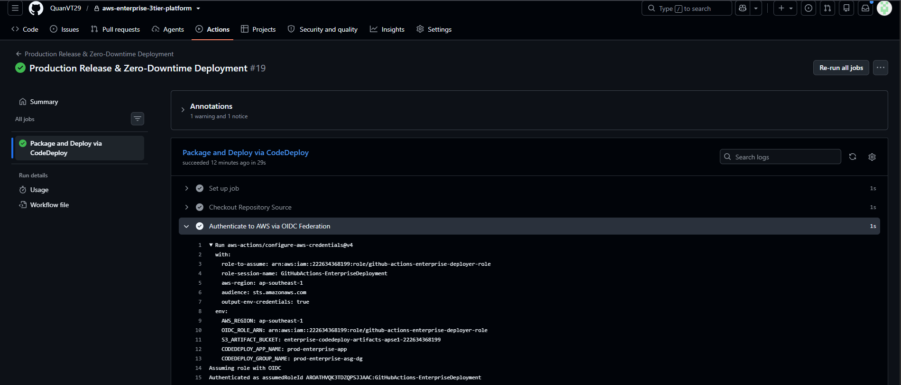

# Phase 2: Shift-Left Security & GitOps CI/CD Pipeline

## 1. Architectural Scope & Objectives

The primary objective of Phase 2 is to eliminate manual operational friction, enforce security governance upstream, and achieve automated, zero-downtime application delivery using **GitHub Actions**, **AWS IAM OpenID Connect (OIDC)**, and **AWS CodeDeploy**.

Adhering to DevSecOps principles, this phase establishes:
- **Zero Static Secrets:** Eliminating long-lived access keys (`AWS_ACCESS_KEY_ID` and `AWS_SECRET_ACCESS_KEY`) from version control.
- **Shift-Left Security Gate:** Automated policy-as-code and vulnerability checks on every Pull Request.
- **Automated Rolling Updates:** Zero-downtime deployments integrated directly with the Phase 1 Application Load Balancer and Auto Scaling Group.

```text
  [ Developer ]
        │ (git push / Pull Request)
        ▼
  [ GitHub Repository ]
        │
        ├──> [ Trigger: Shift-Left Security Gate ]
        │         ├── TFLint (Syntax & Best Practices)
        │         ├── Checkov (IaC Misconfigurations)
        │         └── Trivy (Dependency & Package CVEs)
        │
        ▼ (PR Merged / Push to Main)
  [ AWS IAM OIDC Auth ] ──(Exchange JWT for Short-lived STS Token)──> [ AWS Cloud ]
        │
        ▼ (Stage 1)
  [ Deploy to Staging ]
        │
        ▼ (Stage 2: Manual Approval Gate)
  [ GitHub Environment Protection Review ]
        │
        ▼ (Stage 3)
  [ AWS CodeDeploy ] ──(Rolling Update + Health Check)──> [ EC2 ASG Instances ]
```

<br>



## 2. Technical Specifications & Toolchain

### 2.1 Identity Federation (Passwordless OIDC)

- Mechanism: Direct federated trust between GitHub Actions and AWS Security Token Service (STS) via OpenID Connect (OIDC).

- Audience (aud): sts.amazonaws.com.

- Subject (sub Claim Restriction): Scoped strictly to the specific organization and repository (repo:<ORG>/<REPO>:*), preventing unauthorized token exchange from external repositories.

- Session Duration: 3600 seconds (ephemeral credentials automatically invalidated upon job completion).
  

### 2.2 Shift-Left Security Scanners

- Terraform Linter (tflint): Validates syntax, naming conventions, and enforces cloud provider best practices across all root and child modules.

- Infrastructure-as-Code Static Analysis (checkov): Scans Terraform manifests against CIS AWS Benchmarks. Blocks merges on critical security violations (e.g., world-open security groups, unencrypted EBS storage).

- Vulnerability Scanner (trivy): Analyzes package.json dependencies and system libraries for known Common Vulnerabilities and Exposures (CVEs) with severity levels HIGH and CRITICAL.


### 2.3 Automated Deployment Strategy (AWS CodeDeploy)

- Deployment Configuration: CodeDeployDefault.OneAtATime to ensure progressive rollout across the Auto Scaling Group.

- Load Balancer Integration: Automatic target deregistration, connection draining, and post-update target registration.

- Lifecycle Event Hooks:

1. ApplicationStop: Gracefully stops the existing service.

2. BeforeInstall: Cleans up previous application artifacts and prepares directory permissions.

3. AfterInstall: Extracts new code and installs production dependencies.

4. ApplicationStart: Starts the systemd application daemon.

5. ValidateService: Executes local curl probes against /healthz to confirm service health before returning the instance to the ALB target pool.

<br>


## 3. Pipeline Directory Layout


```text
aws-enterprise-3tier-platform/
├── .github/
│   └── workflows/
│       ├── iac-security-scan.yml      # Shift-Left Security Scanners (PR Trigger)
│       └── release-deploy.yml         # OIDC Auth, Staging & Production Deployment
├── app/
│   ├── appspec.yml                    # CodeDeploy deployment specification
│   ├── scripts/
│   │   ├── stop_server.sh             # ApplicationStop hook
│   │   ├── before_install.sh          # BeforeInstall hook
│   │   ├── after_install.sh           # AfterInstall hook
│   │   ├── start_server.sh            # ApplicationStart hook
│   │   └── validate_service.sh        # ValidateService hook
│   └── src/
│       └── server.js                  # Application source code
└── terraform/
    └── global/
        └── oidc.tf                    # IAM OIDC Provider and Execution Roles
```


<br>


## 4. Pipeline Execution Workflow

### Stage 1: Pull Request Verification (Automated Security Gate)

Whenever a developer creates or updates a Pull Request targeting the main branch, the iac-security-scan.yml workflow triggers:

1. Checks out the repository.

2. Initializes and runs tflint.

3. Runs checkov across all Terraform directories.

4. Executes trivy on application dependencies.

5. If any scanner detects high-severity violations, the pipeline halts with exit code 1, and branch protection rules prevent merging.


### Stage 2: Build & Staging Rollout

Upon merging into main:

1. Authenticates to AWS via IAM OIDC.

2. Bundles the application source code and deployment hooks into a tarball.

3. Uploads deployment artifacts to an S3 deployment bucket.

4. Triggers AWS CodeDeploy to update the staging environment.

### Stage 3: Production Approval Gate & Zero-Downtime Deployment

1. Workflow pauses at the GitHub Environment production-gate.

2. Requires explicit manual sign-off from authorized approvers.

3. Upon approval, AWS CodeDeploy executes a rolling update across production ASG instances.

4. ALB connection draining prevents traffic loss while each node is updated sequentially.


<br>


## 5. Verification & Testing Scenarios

### Scenario 1: Identity Federation via IAM OIDC (Passwordless Auth)

- Objective: Verify that the CI/CD runner establishes trusted sessions with AWS without long-lived access keys.

- Execution: Trigger a workflow run and inspect the execution log of the aws-actions/configure-aws-credentials action.

- Verification Criteria: The runner assumes the designated IAM role via sts:AssumeRoleWithWebIdentity, displaying an authenticated AWS Account ID and temporary session identifier.




### Scenario 2: Shift-Left Security Gate Enforces Policy-as-Code

- Objective: Prove that the pipeline actively intercepts insecure infrastructure code before deployment.

- Execution: Create a test branch with an intentional security violation (e.g., adding an ingress rule for 0.0.0.0/0:22 in modules/security_groups/main.tf) and submit a Pull Request.

- Verification Criteria:

1. Checkov flags finding CKV_AWS_24: Ensure no security groups allow ingress from 0.0.0.0:0 to port 22.

2. The CI workflow fails, setting the PR status check to red and disallowing merge.

### Scenario 3: AWS CodeDeploy Lifecycle Events Validation

- Objective: Confirm that deployment lifecycle hooks execute sequentially and accurately report deployment health.

- Execution: Review the deployment history within the AWS CodeDeploy Console for the target Auto Scaling Group.

- Verification Criteria: All deployment phases (ApplicationStop, BeforeInstall, AfterInstall, ApplicationStart, ValidateService) indicate Succeeded status across all target compute nodes.

### Scenario 4: Zero-Downtime Rolling Deployment Verification

- Objective: Guarantee continuous availability and 0% HTTP 5xx errors during active production rollouts.

- Execution:

1. Initiate a continuous HTTP probe loop targeting the ALB endpoint:

```
ALB_URL="http://<YOUR-ALB-DNS-NAME>"
while true; do
  curl -s -o /dev/null -w "%{http_code} - %{time_total}s\n" "$ALB_URL/healthz"
  sleep 0.5
done
```

2. Trigger a production deployment containing an updated application version string.

#### Measured Result:

- Continuous traffic logging maintains 100% 200 OK responses throughout the rolling update.

- Measured HTTP 5xx rate: 0.0%.

- Traffic seamlessly transitions to serving the updated version string upon target group re-registration.


<br>


## 6. Challenges Encountered & Resolutions

| Challenge / Incident | Root Cause Analysis | Remediation |
| :--- | :--- | :--- |
| **`sts:AssumeRoleWithWebIdentity` Access Denied** | The IAM Trust Policy `StringEquals` condition contained a minor typo in the repository name claim. | Corrected the trust policy subject claim format to `repo:<org>/<repo>:ref:refs/heads/main`. |
| **CodeDeploy `ValidateService` Hook Timeout** | The application daemon took 8 seconds to bind to port 8080, but curl was executed immediately. | Added a retry loop with sleep intervals within `validate_service.sh` to await successful HTTP 200 response. |
| **Checkov Baseline Discrepancies** | Local development environments ran a different version of Checkov than the GitHub Actions runner. | Pinned the exact container image version of Checkov (`bridgecrew/checkov:3.x`) inside the workflow definition. |
