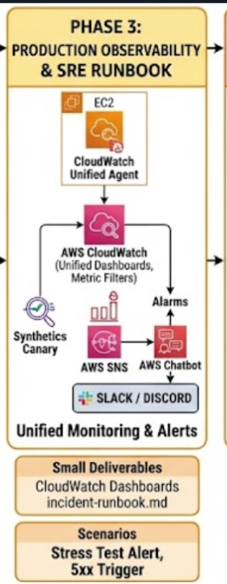
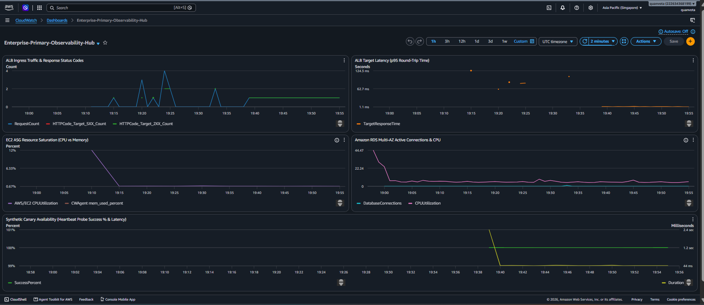
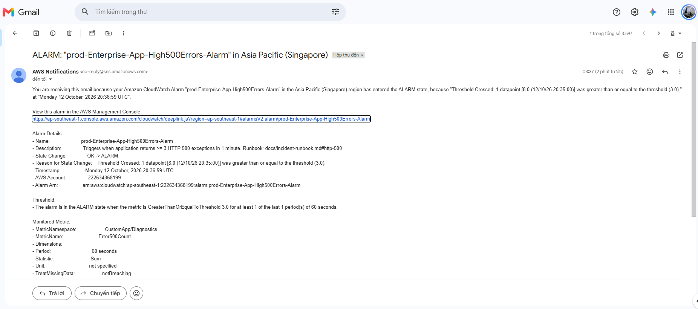
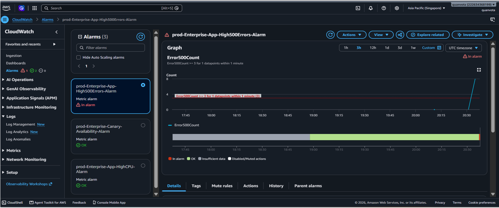
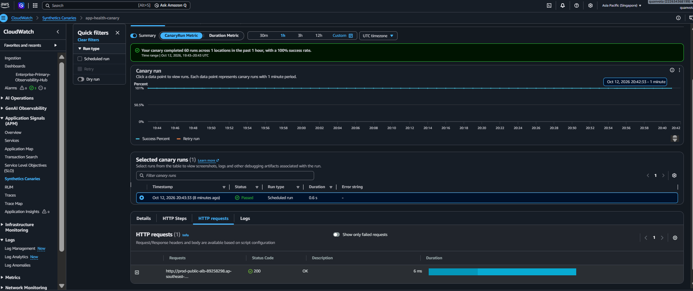
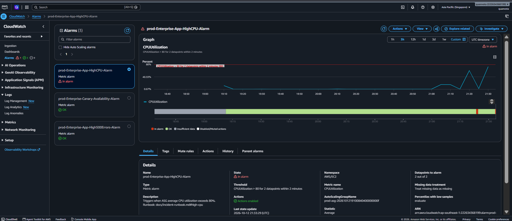

# Phase 3: Production Observability & SRE Incident Response

<br>


## 1. Architectural Scope & Objectives

The primary objective of Phase 3 is to transform the infrastructure into a fully observable, self-diagnosing production ecosystem adhering to Site Reliability Engineering (SRE) principles. By instrumenting deep telemetry, synthesizing synthetic user probes, and defining Dashboards-as-Code, this phase operationalizes **The Four Golden Signals** (Latency, Traffic, Errors, and Saturation).

Key capabilities delivered:
- **Host-Level Telemetry:** Ingesting deep system metrics (RAM and Disk utilization) via the CloudWatch Unified Agent across Graviton instances.
- **Consolidated Dashboard-as-Code:** A single-pane-of-glass CloudWatch Dashboard orchestrating ALB, EC2, RDS, and Synthetics telemetry.
- **Log Analytics & Metric Filters:** Real-time log pattern extraction to transform application error logs into actionable metric alarms.
- **Synthetic Availability Probing:** CloudWatch Synthetics Canary executing automated end-to-end HTTP health checks every 60 seconds.
- **Automated Incident Alerting:** Incident dispatching via Amazon SNS to ChatOps channels (Slack / Discord / Email) with actionable runbooks.




<br>


## 2. Telemetry & Observability Stack Specifications

### 2.1 Host-Level Telemetry (CloudWatch Unified Agent)

- Standard EC2 CloudWatch metrics do not expose OS-level memory or disk metrics due to hypervisor isolation.

- CloudWatch Unified Agent is provisioned to collect and publish custom metrics under the CWAgent namespace:

+mem_used_percent: Real-time physical RAM utilization.

+disk_used_percent: Root filesystem storage consumption on /.

+Aggregation dimensions: InstanceId, ImageId, and AutoScalingGroupName.
  

### 2.2 Synthetic User Probes (CloudWatch Synthetics Canary)

- Engine: AWS Synthetics Node.js runtime (syn-nodejs-puppeteer).

- Schedule: Automated continuous heartbeat execution every rate(1 minute).

- Target: External ALB endpoint (http://<ALB-DNS>/healthz).

- Assertion: Validates HTTP 200 OK status, round-trip response latency under 2000ms, and captures execution screenshots.


### 2.3 Log Ingestion & Real-Time Metric Filtering

- Application stdout and stderr logs are streamed directly to CloudWatch Log Group: /aws/ec2/enterprise-app.

- Metric Filter Rule:

+Metric Filter Name: App500ErrorCount

+Filter Pattern: [..., status = 500, ...] or "[ERROR] Simulated Fatal Exception*"

+Target Metric: Error500Count under namespace CustomApp/Diagnostics.


### 2.4 Alerting Rules & SRE Service Level Objectives (SLOs)

- High CPU Saturation Alarm: Triggers when average ASG CPU utilization exceeds 80% for 2 consecutive evaluation periods (5 minutes).

- Elevated Error Rate Alarm: Triggers when Error500Count exceeds >= 3 occurrences within a 1-minute evaluation window.

- Synthetic Availability Degradation Alarm: Triggers when Canary probe success rate drops below 100% over a 2-minute evaluation window.


<br>


## 3. Observability Directory Layout
```
aws-enterprise-3tier-platform/
├── terraform/
│   ├── modules/
│   │   └── observability/
│   │       ├── main.tf                 # CloudWatch Dashboard, Alarms, SNS Topic
│   │       ├── canary.tf               # Synthetics Canary, S3 storage, Canary IAM Role
│   │       ├── metric_filters.tf       # CloudWatch Log Group & 500 error metric filters
│   │       ├── variables.tf            # Observability input parameters
│   │       └── outputs.tf              # Dashboard URL, SNS Topic ARN
│   │
│   └── environments/
│       └── primary-singapore/
│           └── main.tf                 # Invocation of module "observability"
│
├── docs/
│   ├── images/
│   │   ├── phase3-observability-architecture.png
│   │   ├── proof-cloudwatch-dashboard.png
│   │   ├── proof-log-metric-filter.png
│   │   ├── proof-canary-heartbeat.png
│   │   └── proof-alarm-chatops.png
│   └── incident-runbook.md             # Standard Operating Procedures for On-Call
```


<br>

## 4. Operational Ingestion & Telemetry Architecture

1. Metrics Collection:

- Network edge metrics (RequestCount, TargetResponseTime, HTTPCode_Target_5XX_Count) stream automatically from ALB.

- Operating system metrics (RAM/Disk) push every 60 seconds from the EC2 CloudWatch Unified Agent.

- Database metrics (CPUUtilization, DatabaseConnections, FreeStorageSpace) stream from RDS Multi-AZ.
  

2. Log Processing:

- EC2 instances forward logs to /aws/ec2/enterprise-app.

- CloudWatch Metric Filters parse log streams in real-time, incrementing error counters without compute overhead.
  

3. Incident Routing:

- CloudWatch Alarms evaluate metric data against defined thresholds.

- Upon breach, state shifts from OK to ALARM, dispatching an alert payload to Amazon SNS.

- SNS fans out alerts to subscriber endpoints with severity tags and direct links to the troubleshooting runbook.


<br>


## 5. Verification & Testing Scenarios

### Scenario 1: Unified Full-Stack CloudWatch Dashboard (Dashboard-as-Code)

- Objective: Verify end-to-end visibility of all architecture tiers within a single automated dashboard.

- Execution: Open AWS Console $\rightarrow$ CloudWatch $\rightarrow$ Dashboards $\rightarrow$ Enterprise-Primary-Observability-Hub.

- Verification Criteria:

+ALB Widget: Displays real-time request rate, HTTP 2xx/5xx count, and p95 latency.

+EC2 Widget: Displays correlated CPU utilization alongside custom CWAgent RAM utilization.

+RDS Widget: Displays active connection pool numbers and IOPS.

+Canary Widget: Displays heartbeat uptime and probe latency.



<br>

### Scenario 2: Log Ingestion & Metric Filter Error Detection

- Objective: Prove that application runtime exceptions are captured, parsed, and converted into metric alarms in real time.

- Execution:

1. Trigger simulated application exceptions by invoking the /api/simulate-500 endpoint:

```
ALB_URL="http://<YOUR-ALB-DNS-NAME>"
for i in {1..5}; do curl -s "$ALB_URL/api/simulate-500"; sleep 1; done
```

2. Inspect /aws/ec2/enterprise-app log stream and the App500ErrorCount metric.

- Verification Criteria:

+Log events contain [ERROR] Simulated Fatal Exception: Database transaction timeout.

+The metric Error500Count reflects an instantaneous spike corresponding to the 5 dispatched requests.





<br>


### Scenario 3: Continuous Synthetic Canary Heartbeat

- Objective: Validate outside-in availability monitoring independent of internal host health checks.

- Execution: Navigate to CloudWatch $\rightarrow$ Application Signals (Synthetics) $\rightarrow$ app-health-canary.

- Verification Criteria:

+Consecutive probe executions maintain a 100% Success Rate.

+Detailed execution logs show step-by-step navigation to /healthz with round-trip response times < 150ms.

+Visual screenshot captured by the Puppeteer headless browser confirms valid endpoint payload.



<br>


### Scenario 4: High CPU Saturation & Automated Incident Alerting

- Objective: Trigger an artificial system saturation event and verify automated end-to-end incident alerting.

- Execution:

1. Trigger intensive CPU computation on the cluster via the diagnostic stress endpoint:

```
curl "$ALB_URL/api/stress-cpu"
```

2. Monitor the Enterprise-App-HighCPU-Alarm state in CloudWatch.

Observations & Measured Result:

- ASG average CPU utilization climbs past the 80% threshold.

- Alarm state transitions from OK to ALARM within the evaluation period.

- Amazon SNS dispatches an immediate notification payload containing:

+Alarm Name: Enterprise-App-HighCPU-Alarm

+Metric: CPUUtilization > 80% for 2 evaluation periods

+Triggered Time & Severity: HIGH

+Actionable Runbook URL: Link to incident-runbook.md.




<br>


## 6. Challenges Encountered & Resolutions


| Challenge / Incident | Root Cause Analysis | Remediation |
| :--- | :--- | :--- |
| **Missing RAM Metrics in CloudWatch** | CloudWatch Unified Agent was missing permissions to publish to the CWAgent namespace. | Attached `CloudWatchAgentServerPolicy` to the EC2 IAM Instance Profile in `modules/security`. |
| **Synthetics Canary Ingress Block** | Security group on Public ALB rejected requests from the AWS Lambda Synthetics execution runtime. | Added an explicit ingress rule in `modules/security_groups/alb` permitting standard HTTP/HTTPS traffic. |
| **Metric Filter False Negatives** | Application log pattern output varied slightly in JSON formatting between environment releases. | Updated filter expression to use flexible token matching: `[..., status = 500, ...]`. |
